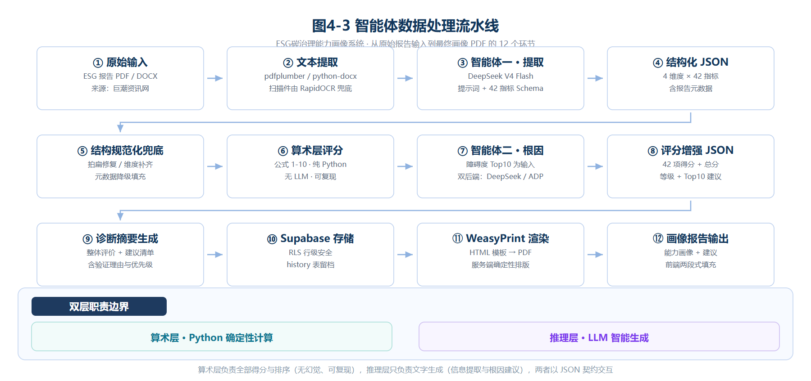
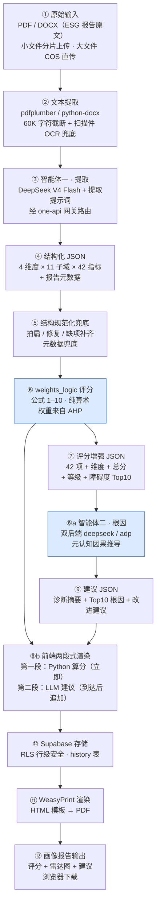
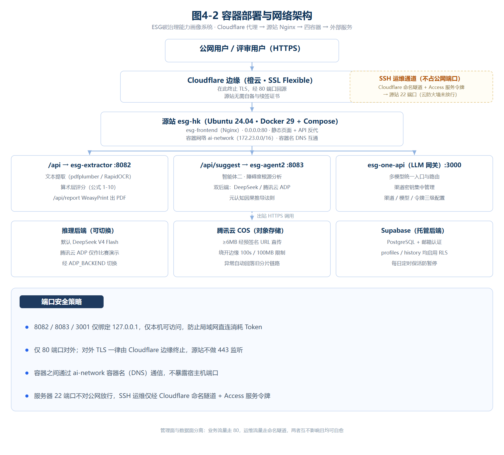

# 架构说明 · ESG 碳治理能力画像系统

> 本文档描述系统的设计原则、分层结构、数据流水线、容器编排、评分算法与部署形态。
> 配套图纸见 [`docs/architecture/`](docs/architecture/)（论文图 4-1 / 4-2 / 4-3）。
> 图号按正文首次出现顺序编排（4.2 → 图 4-1、4.4 → 图 4-2、4.5 → 图 4-3）；
> 每张图同时提供 `.svg` 矢量源与 300 dpi `.png`，改图请改 SVG 后重新导出。

---

## 1. 设计原则

### 1.1 双层职责边界（首要约束）

系统把"算数"和"理解"彻底拆开，这是全部架构决策的出发点：

| | 算术层 | 推理层 |
| --- | --- | --- |
| 载体 | `weights_logic.py`（纯 Python） | 智能体一 / 智能体二（LLM） |
| 输入 | 结构化指标节点 + `weights.json` | ESG 报告原文 / 增强 JSON |
| 输出 | 完整度、质量、基础分、对标分、L4、维度分、总分、障碍度 | 指标抽取结果、诊断摘要、Top10 根因、改进建议 |
| 特性 | 确定性、幂等、可复现、可审计 | 语义理解、生成式、需提示词约束 |
| 禁忌 | **不得引入任何 LLM 判断** | **不得自行计算或改写任何分数** |

**为什么必须这样拆**：

1. **可复现**——评分结果可被评委、老师用算盘重算，模型版本变化不影响分数；
2. **可审计**——每一分的来源都能定位到 `weights.json` 里的权重与规则；
3. **可降级**——LLM 不可用时，分数照旧产出，只是缺少"建议"这一段（前端两段式渲染正是为此设计）。

### 1.2 确定性优先

能用公式表达的，绝不交给模型。典型体现：

- 对标分不走"让模型评价一下这份报告好不好"，而是查行业基准库 + 分档函数；
- 行业基准库缺失 / 样本不足时，走**显式降级**规则而非模型兜底；
- 提取阶段的模型只负责"从原文找数"，返回结构由 JSON Schema 约束。

### 1.3 自主可控与低成本

| 选择 | 理由 |
| --- | --- |
| DeepSeek 作为默认推理后端 | 成本低、可直调，开源部署时**零平台配置**即可跑通 |
| 腾讯云 ADP 作为可选后端 | 比赛展示环节使用，通过 `ADP_BACKEND=adp` 一键切换 |
| one-api 作为统一网关 | 业务代码不接触各家密钥，前端可切模型而无需改后端 |
| 第三方前端库全部本地化 | 断网 / 弱网现场也能演示 |
| RapidOCR 离线兜底 | 扫描件不依赖任何云 OCR 服务 |

---

## 2. 三层架构总览


```
┌─────────────────────────────────────────────────────────────┐
│ 用户交互层（前端 SPA · 原生 JS + Chart.js，无构建步骤）        │
│  首页引导 │ 报告上传 │ 提取展示 │ 评分可视化 │ 金融评估模块   │
└───────────────────────────────┬─────────────────────────────┘
                                │ 同源相对路径 /api/*（Nginx 反代）
┌───────────────────────────────▼─────────────────────────────┐
│ 服务层（Docker Compose 四容器）                               │
│  esg-frontend    esg-extractor    esg-agent2    esg-one-api  │
│  Nginx · :80     Flask · :8082    Flask · :8083  网关 · :3000 │
└───────────────────────────────┬─────────────────────────────┘
                                │
┌───────────────────────────────▼─────────────────────────────┐
│ 模型与数据层（外部服务）                                      │
│  DeepSeek 官方 API（提取 / 根因）   Supabase（认证 + 历史）    │
└─────────────────────────────────────────────────────────────┘
```

**前端只用同源相对路径**（`/api`），不写死 `localhost` 或域名——这同时解决了三个问题：公网用户不会把 `localhost` 解析到自己机器；避免 HTTPS 页面请求 HTTP 的混合内容拦截；本机与公网部署共用同一份代码。

---

## 3. 数据流水线



从原始报告到最终画像的 12 步：



**关键点**：⑥ 与 ⑧a 是**并行**的两条腿。分数在 ⑥ 就已经完全确定，⑧b 立即把分数渲染出来（用户不必等 LLM），⑧a 产出建议后再追加渲染。这就是"两段式渲染"，它让首屏出分时间从"等 LLM 的几十秒"压缩到"几秒"。

**上传双链路**：① 到 ② 之间有两条入口。小于 6MB 走常规分片上传，由服务器中转；达到阈值则先尝试对象存储直传——后端签发预签名 URL，浏览器直接 PUT，服务器只在完成时取件，从而绕开"浏览器 → 服务器 → 存储"的两跳。直传任一环节异常（浏览器不支持、CORS 未放行、签名失败）都先记日志再原样落回分片链路，**功能不会因此不可用**。

---

## 4. 容器编排与网络



### 4.1 四容器职责

| 容器 | 镜像 / 基础 | 端口 | 职责 |
| --- | --- | --- | --- |
| `esg-frontend` | nginx（静态 + 反代） | `80` | 静态资源托管、API 反向代理、gzip、长缓存策略 |
| `esg-extractor` | python:3.13-slim | `8082` | 文本提取、智能体一调用、**确定性评分**、WeasyPrint PDF |
| `esg-agent2` | python:3.13-slim | `8083` | 智能体二根因分析（双后端 deepseek / adp） |
| `esg-one-api` | `ghcr.io/songquanpeng/one-api` | `3000` | LLM 统一网关，多平台渠道与分发 Token 管理 |

### 4.2 网络与端口安全策略

```
宿主 80  ──► esg-frontend（唯一对外入口）
                 ├── /api/         ──► esg-extractor:8082
                 ├── /api/suggest  ──► esg-agent2:8083
                 └── /api/report   ──► esg-extractor:8082
```

- 自定义网络 `ai-network`（`172.23.0.0/16`）。**必须显式建网**：Docker 默认 bridge 用的 `172.17.0.0/16` 与部分校园网 / 内网段冲突，会导致容器间解析异常。
- 容器内一律通过**容器名寻址**（`esg-extractor:8082`），不走宿主机端口。
- **8082 / 8083 / 3001 一律只绑 `127.0.0.1`**：防止同局域网内他人直连后端消耗 API 额度。nginx 在 `ai-network` 内部访问不受影响。
- 提取与根因接口的超时按最长链路配置：`/api/` 读写超时 900s（覆盖扫描件 OCR 约 6 分钟的场景），`/api/suggest` 300s，`/api/report` 180s。

### 4.3 静态资源缓存策略

| 资源 | Header | 理由 |
| --- | --- | --- |
| `js / css / 字体 / 图片` | `public, max-age=31536000, immutable` | 全部带 `?v=NN` 版本号，改版即换 URL，长缓存安全 |
| `index.html` | `no-cache` | 入口必须每次协商，否则新版本发布后用户被锁死在旧版一年 |
| 文本类资源 | gzip 压缩（level 5，≥1KB） | 穿隧道 / 弱网场景实测可减少 60–75% 传输量 |

> ⚠️ 改了哪个静态资源就 bump **那个资源**的 `?v=NN`：戳记按资源独立维护，只改内容不换戳会让老用户继续吃一年长缓存；反过来无谓地全量 bump，会让所有用户白下一遍。

---

## 5. 评分引擎详解

### 5.1 指标树

```
4 个维度（L1）
  └── 11 个子领域（L4 分组）
        └── 42 项 L4 指标（评分最小单元）
```

四个维度：**企业内部碳管理 / 供应链碳管理 / 透明度 / 金融化情况**。

### 5.2 权重来源（AHP）

```
94 家上市公司 ESG 报告
   ↓ 词频统计（各 L4 指标的披露频次）
   ↓ 频次 → 重要性映射（1 / 3 / 5 / 7 / 9）
   ↓ AHP 层次分析（构造判断矩阵 → 求特征向量 → 一致性检验）
   ↓ 归一化
weights.json  ·  42 项全局权重
```

### 5.3 单指标评分链（公式 1–10）

| 步骤 | 函数 | 输出 | 说明 |
| --- | --- | --- | --- |
| 1 | `calc_completeness` | 0–3 | 该指标下设子问题被回答的数量 |
| 2 | `calc_quality` | 0–3 | 表述是否量化、是否有数据支撑 |
| 3 | `calc_basic_score` | 0–6 | 完整度 + 质量 |
| 4 | `calc_benchmark_score` | 0–4 | 与行业基准 / 全市场中位数比较后分档 |
| 5 | `calc_l4_score` | — | `(基础分 + 对标分) × 全局权重` |
| 6 | `calc_obstacle` | — | `权重 × 失分率`，衡量对总分的拖累 |
| 7 | `map_level` | S/A/B/C | 总分等级映射 |
| 8 | `classify_loss_type` | 类型标签 | 区分"未披露 / 披露不全 / 披露不量化"三类失分 |
| 9 | `resolve_industry_mean` | 行业均值 | **降级容错**：行业不在库 or 样本 < 10 家 → 全市场均值 |
| 10 | `score_all` | 全量结果 | 聚合到维度分与总分 |

### 5.4 `weights.json` 结构

```jsonc
{
  "说明": "ESG碳治理能力评分 - 前端本地查表数据（替代向量库检索）",
  "版本": "v1.0",
  "创建日期": "2026-08-14",
  "数据源": { "全局权重": …, "行业基准库": …, "全市场中位数": … },
  "全局权重":   { /* 42 项指标 → 权重 */ },
  "行业基准库": { /* 11 个行业 → 各指标均值 */ },
  "全市场中位数": { /* 42 项指标 → 全市场中位数 */ },
  "评分规则": {
    "完整度分": …, "质量分": …, "基础分": …,
    "对标分": …, "L4得分": …, "总分": …, "等级映射": …
  },
  "非上市版规则": { "有公开证据": …, "无公开证据": …, "权重调整": … }
}
```

**双轨权重**：上市公司按 42 项指标全量对标；非上市公司因公开披露口径不同，走 `非上市版规则`，按"有无公开证据"分别给分并调整权重，避免用同一把尺子量两类主体。

---

## 6. 提示词工程

| 智能体 | 提示词 | 位置 | 要点 |
| --- | --- | --- | --- |
| 智能体一 · 提取 | `extraction_prompt.md` | 提取服务 | 严格 JSON Schema；只做抽取不做判断；缺失项显式标记而非编造 |
| 智能体二 · 根因 | `agent2/system_prompt.md` | agent2 容器 | v3.0「障碍度根因分析专家」；防误导占位符；元认知因果推导 |
| 智能体二 · 用户模板 | `agent2/user_prompt.md` | agent2 容器 | 注入评分增强 JSON + 障碍度 Top10 |
| ADP 版短提示词 | `智能体二评分提示词-ADP短提示词-v2.0.md` | 仓库根 | 腾讯云 ADP 工作流版本 |

**智能体二的推导方法（元认知因果推导法则）**：

```
锁定终点（分数失在哪一项）
   ↓ 逆向推演（为什么这一项拿不到分：未披露？披露不全？未量化？）
   ↓ 解法验证（给出可落地动作，并回指到具体指标）
```

因为智能体二只**读**分数、只**写**建议，从架构上就不可能污染算术层的结果。

---

## 7. 前端渲染

原生 JS + Chart.js，**无构建步骤**（改完刷新即生效），两段式渲染：

```
用户点击「开始分析」
   │
   ├─ 第一段（Python 已算好，立即渲染）
   │    评分卡片 / 雷达图 / 圆环 / 三色评分点 / 维度 Tab
   │
   └─ 第二段（LLM 建议到达后追加）
        诊断摘要 / Top10 根因 / 改进建议 / 完整 Markdown 报告
```

- `fillScoreCards()` 同一份数据同时填充**页面画像区**与**PDF 报告区**，保证屏幕与导出报告一致。
- PDF 双通道：优先服务端 WeasyPrint（中文字体内嵌、排版稳定）；不可用时回落客户端 pdfmake。
- `pdfmake.min.js`(1.3MB) 与 `vfs_cn.js`(8.7MB 中文字体) 走**懒加载**，首屏不下载这 10MB。
- 游客模式：`startAnalysis()` 无登录校验，分析完成后才在写历史处判断登录态——因此未登录也能跑完整分析，不影响质量验收。

---

## 8. 部署形态

### 8.1 本机 / 内网

`docker-compose up -d --build`，访问 `http://localhost`。

### 8.2 公网入口（Cloudflare 代理 + 源站 80）

```
浏览器 ──► Cloudflare 边缘（代理模式，SSL 在此终止）
              │  回源 HTTP :80
              ▼
        esg-frontend (nginx) ──► 提取 / 根因 / 网关容器（仅内网可达）
```

- **证书不在源站**：SSL 模式选 Flexible，源站 nginx 只监听 80。省掉反向代理证书组件与续期流程，也不必开放 443。
- **只有 80 对外**：8082 / 8083 / 3001 全部不映射宿主端口，只在 `ai-network` 内网按容器名互访。
- **云防火墙在网络层**：安全组规则不落主机 `iptables`，判断端口是否放行要以**外部探针**结果为准；`ss -lntp` 只能证明"服务在监听"，不能证明"外部可达"，容易给出误导性结论。
- **源站与开发机解耦**：前端、后端、鉴权全在服务器上闭环，关掉本机开发环境网站照常服务。

### 8.3 服务器与自愈

| 组件 | 自启方式 | 重启后行为 |
| --- | --- | --- |
| 四个业务容器 | `restart: unless-stopped` | 宿主机重启后自动全起 |
| 管理隧道（可选） | systemd `Restart=always` | 自动重连并重新注册边缘连接 |
| 周期保活任务 | systemd timer（`Persistent=true`） | 错过的触发点开机后补跑 |

> 服务器部署在**无需 ICP 备案的地区**时，不存在"备案期不得解析域名"这条约束，域名可直接解析并对外服务。

### 8.4 管理通道（不暴露 22）

用 **Cloudflare 命名隧道 + Access 服务令牌**替代对公网开放 SSH：

1. **先**建 Access 应用与策略（仅允许服务令牌）→ **再**建 DNS 记录 → **最后**装隧道。顺序反了就会出现"隧道已通但尚未鉴权"的裸露窗口。
2. 客户端用 `cloudflared access tcp` 把远端 22 映射到本机回环端口，之后照常 `ssh`。
3. 校验服务令牌要分清两个值：**请求头填令牌的 `client_id`，策略里引用的才是令牌 `id`**。填错只会得到 `websocket: bad handshake`，看不到 403，极易误判成网络故障。

> 这条通道与网站完全解耦：关掉客户端不影响网站；隧道掉线时 systemd 自动拉起。

---

## 9. 关键工程决策与踩坑

| # | 问题 | 结论 |
| --- | --- | --- |
| 1 | `docker compose`（空格）报 `unknown shorthand flag` | 统一使用 `docker-compose`（连字符） |
| 2 | 默认 bridge 网段 172.17 与校园网冲突 | 显式创建 `ai-network`（172.23.0.0/16） |
| 3 | one-api 渠道配好却 404 | 渠道「模型」字段必须填**底层真实模型名**（`deepseek-chat` / `deepseek-reasoner`），分发 Token 的模型范围要勾全，渠道密钥不能为空 |
| 4 | 改 `models.py` 后只有一个容器生效 | extractor 与 agent2 **两个容器都要重建**（`models.py` 各有一份） |
| 5 | 静态资源改版后用户仍是旧版 | `index.html` 必须 bump `?v=NN`；发布前务必摘掉调试期加的 `no-store` |
| 6 | 扫描件 PDF 提取为空 | RapidOCR 离线兜底；注意用 `opencv-python-headless`（slim 镜像无 `libGL.so.1`）且 onnxruntime 依赖 `libgomp1` |
| 7 | 大报告上传被 413 拦截 | 上传上限需在**前端 / nginx / Flask / 容器**四处同步（现为 200MB） |
| 8 | WeasyPrint 输出的 PDF 中文变方块 | 字体必须 `COPY` 进镜像到 fontconfig 标准路径并 `fc-cache -f` |
| 9 | 管理隧道偶发掉线 | 交给 systemd `Restart=always` 自动重连与重注册；客户端侧无需看门狗 |
| 10 | 大报告上传慢（99.8MB 约 4 分半） | 改走对象存储直传：后端签**预签名 URL**，浏览器直接 PUT，服务器不中转。实测 98MB ≈ 37 秒；原分片链路完整保留作回落，任一异常自动降级 |
| 11 | 预签名 URL 手工替换域名后 403 | 签名里包含 host，必须使用签发时的同一端点（例如全球加速端点）。这类"快速失败"容易被误判为"加速没生效" |
| 12 | 怎么确认容器内代码是最新的 | 别只看 `docker inspect` 的镜像 ID；直接 `docker exec <容器> ls -la` 看容器内实际文件 |
| 13 | 服务器重启能否自愈 | 逐项实测而非推断：容器重启策略、隧道自启、timer `Persistent` 三样各验一次（实测 39 秒全部恢复） |

更完整的历史复盘（15 个 Bug / 4 类根源 / 排查清单）见 [`docs/ESG碳画像系统排障复盘-20260816.docx`](docs/)。

---

## 10. 演进与扩展点

| 方向 | 说明 |
| --- | --- |
| 权重版本化 | `weights.json` 已带版本号与数据源快照，后续只需替换文件即可换权重体系 |
| 后端可插拔 | 智能体二已抽象双后端；新增平台只需实现同一 `/api/suggest` 契约 |
| 多报告对比 | 现有 `history` 表 + 多企业对比模块，可扩展为组合画像 |
| 异步任务 | 已具备 `extract_async` + 分片上传，可平移到大文件队列削峰 |
| 指标框架扩展 | 42 项指标由 `extraction_prompt.md` + `weights.json` 共同定义，扩指标需同步两处 |

---

*本架构说明与 [README.md](README.md) 保持同步；修改架构或版本号时请同批更新。*
