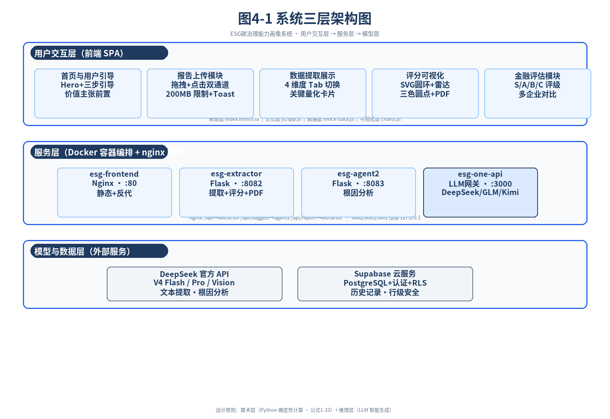

# 碳治 · 智评 —— ESG 碳治理能力画像系统

> 面向企业与金融机构的碳治理能力评估系统。
> **DeepSeek 提取 42 项指标 → Python 确定性算分 → LLM 智能体根因分析 → 前端可视化画像**

用户上传一份 ESG 报告（PDF / Word）后，系统自动完成"提取 → 评分 → 根因诊断 → 改进建议 → 画像报告"全链路，全程无需人工录入。

- 覆盖 **4 大维度 × 11 个 L4 子领域 × 42 项 L4 指标**
- 权重体系来自 **94 家上市公司 ESG 报告词频统计 + AHP 层次分析法**
- 算术层与推理层**职责严格分离**：分数 100% 可复现，建议可溯源

---

## 目录

- [核心特性](#核心特性)
- [系统架构](#系统架构)
- [快速启动](#快速启动)
- [复现与 AI 辅助部署](#复现与-ai-辅助部署)
- [目录结构](#目录结构)
- [环境变量](#环境变量)
- [API 一览](#api-一览)
- [评分方法论](#评分方法论)
- [版本沿革](#版本沿革)
- [幻觉抑制与可信度](#幻觉抑制与可信度)
- [交互稳健性（防「静默失效」）](#交互稳健性防静默失效)
- [许可与溯源](#许可与溯源)

---

## 核心特性

| 模块 | 能力 |
| --- | --- |
| **提取** | PDF / DOCX 双通道解析；**COS 直传**（≥6MB 走对象存储，实测 98MB ≈ 37s）与 1MB 分片上传双链路（上限 200MB，任一异常自动回落旧链路）；扫描件 RapidOCR 兜底（离线可用）；超长报告**混合控长**（头部连续保留 + 后半配额采样，默认 120K 字符，避免按字符数从头截断而丢失附录中的关键绩效证据） |
| **评分** | 完整度（0–3）/ 质量（0–3）/ 基础分 / 对标分（0–4）/ L4 得分 / 维度得分 / 总分 / 障碍度 Top10，公式 1–10 全确定性实现 |
| **可信度** | **证据强制校验**（v=118，v=124b 修误杀）：参与得分的指标，「原文」必须能在报告全文中定位，否则降级为「未披露」——专拦「报告里并不存在的数值」，实测拦截率 **7.02%**；v=124b 补「引用剥离 / 作用域标签归一 / 通路 B」三类**误杀**修复，38 份 A/B 新增放行 29 条而**「值查无」仍为 0**。详见 [幻觉抑制与可信度](#幻觉抑制与可信度) |
| **对标** | 10 个行业基准库 + 全市场中位数；上市 / 非上市双轨权重；样本不足自动降级到全市场均值 |
| **诊断** | 智能体二输出「诊断摘要 + Top10 短板根因 + 改进建议」，采用元认知因果推导（障碍度逆向推演） |
| **可视化** | 雷达图、评分圆环、三色评分点、维度 Tab、多企业对比、S/A/B/C 评级 |
| **报告** | 服务端 WeasyPrint 精美 PDF（中文字体内嵌，v=124 起 **29833 码位全 CJK 覆盖**，繁简 / 生僻字不漏字）+ 客户端 pdfmake 兜底；Word / PPT 导出 |
| **账户** | Supabase 邮箱认证 + 分析历史（PostgreSQL + RLS 行级安全）；**数据提取需登录后使用**（v=115 前端门禁，拦在「选文件」之前，避免用户白传整份大文件） |
| **多模型** | one-api 网关统一路由 DeepSeek / GLM / Kimi / MiniMax，前端下拉切换 |
| **部署** | 四容器 Docker Compose 编排；公网入口走 Cloudflare 代理 + SSL，源站 nginx 直跑 80（免证书运维）；**SSH 管理通道与网站完全解耦**，服务器重启后网站 / 管理通道 / 定时任务全部自愈 |

---

## 系统架构



**三层结构**：用户交互层（前端 SPA）→ 服务层（四容器 Docker 编排）→ 模型与数据层（DeepSeek API / Supabase 云服务）。

### 双层职责边界（核心设计原则）

这是本项目最关键的一条架构约束，也是答辩口径：

| 层次 | 承担者 | 职责 | 性质 |
| --- | --- | --- | --- |
| **算术层** | Python（`weights_logic.py`） | 完整度 / 质量 / 基础分 / 对标分 / L4 / 维度 / 总分 / 障碍度 | 确定性、可复现、可审计，**无 LLM 参与** |
| **推理层** | LLM（智能体一 / 智能体二） | 报告文本 → 结构化指标；失分根源分析 + 改进建议 | 语义理解、生成式，**不作数值计算** |

> 一句话：**能用公式算的绝不用模型猜，需要理解的绝不写死规则。**

完整的架构说明（数据流水线、容器编排、评分算法、工程决策）见 **[ARCHITECTURE.md](ARCHITECTURE.md)**。

---

## 快速启动

### 前置条件

- Docker Desktop（含 Docker Compose）
- 一个 DeepSeek API Key（<https://platform.deepseek.com>）
- 可选：Supabase 项目（仅登录 / 历史功能需要）

### 步骤

```bash
# 1) 配置环境变量
cp .env.example .env
#    编辑 .env，至少填入 DEEPSEEK_API_KEY

# 2) 创建容器网络（首次执行一次即可）
docker network create --subnet 172.23.0.0/16 ai-network

# 3) 构建并启动（四个容器）
docker-compose up -d --build

# 4) 访问
#    前端：  http://localhost
#    健康检查：http://localhost/api/health
```

> ⚠️ **必须使用 `docker-compose`（中间带连字符）**，`docker compose`（空格子命令）在部分环境下会报 `unknown shorthand flag`。

### 验证

```bash
curl http://localhost/api/health
# {"status":"ok","service":"esg-extractor",...}

curl -X POST -F "file=@/path/to/esg_report.pdf" http://localhost/api/extract
```

### 日常运维

```bash
docker-compose ps                      # 容器体检
docker-compose logs -f esg-extractor   # 提取服务日志
docker-compose down                    # 停机
docker-compose up -d                   # 启动
```

---

## 复现与 AI 辅助部署

本仓库**不含任何真实密钥与服务器凭据**（`.env` 已由 `.gitignore` 排除），也**不随仓库下发运维脚本**——克隆即得全部可复现代码。

**仓库地址**：<https://github.com/24203230230/esg-carbon-system>

部署过程可直接交给 AI 编程助手完成。以下工具均可用于本仓库（把仓库地址与目标环境丢给它即可）：

| 工具 | 说明 |
| --- | --- |
| **WorkBuddy** | 办公智能体，可读写本地文件并执行终端命令 |
| **Codex** | OpenAI 编程智能体 |
| **Claude Code** | Anthropic 终端编程智能体 |
| **DeepSeek Harness** | DeepSeek 官方智能体运行框架 |

可直接复制的提示词：

```text
仓库地址：https://github.com/24203230230/esg-carbon-system
目标环境：Ubuntu 24.04 + Docker 29（最低 2 核 2G）

请先阅读 README.md 与 ARCHITECTURE.md，然后：
1) 按 .env.example 生成 .env（密钥我会自己提供，绝不要写进仓库或提交）；
2) 创建容器网络：docker network create --subnet 172.23.0.0/16 ai-network；
3) 用 docker-compose up -d 启动四个容器（frontend / extractor / agent2 / one-api）；
4) 用 curl http://localhost/api/health 验证返回 build=v114。

遇到报错请说明根因与修复步骤，不要跳过验证步骤。
```

> 判断部署是否成功，看 `/api/health` 的 `build` 字段是否等于 `v114`——这是唯一可靠的信号，比页面能否打开更准。

---

## 目录结构

```
esg-carbon-system/
├── docker-compose.yml          # 四容器编排（extractor / frontend / agent2 / one-api）
├── Dockerfile                  # 提取 + 评分服务镜像
├── extract_service.py          # Flask 提取服务（提取 / 分片上传 / COS 直传 / OCR 兜底 / WeasyPrint PDF）
├── weights_logic.py            # ★ 评分引擎：公式 1–10 全实现（确定性算术层）
├── weights.json                # ★ 42 指标权重 + 10 行业基准库 + 全市场中位数 + 评分规则
├── models.py                   # LLM 网关配置与支持模型清单
├── extraction_prompt.md        # 智能体一 · 提取提示词
├── agent2/                     # 智能体二 · 障碍度根因分析服务
│   ├── suggest_service.py      #   /api/suggest（双后端 deepseek | adp）
│   ├── system_prompt.md        #   根因分析提示词 v3.0（元认知因果推导）
│   ├── user_prompt.md
│   ├── peer_retrieval.py       #   检索层：离线同行对标库检索（倒排索引）
│   ├── peer_index.json         #   102 家同行索引（构建产物，随镜像发布，运行时零网络依赖）
│   ├── web_search.py           #   企业公开信息检索（东方财富 / 巨潮资讯，免 Key）
│   └── materiality.py          #   实质性分析（纯 Python 确定性计算）
├── tools/build_peer_index.py   # 重建 peer_index.json 的构建脚本
├── frontend/                   # 前端 SPA（原生 JS + Chart.js，无构建步骤）
│   ├── index.html
│   ├── js/app.bundle.js        #   业务主逻辑
│   ├── js/charts.js            #   雷达图 / 圆环 / 三色评分点
│   ├── vendor/                 #   第三方库本地化（离线可用）
│   └── nginx.conf              #   静态资源 + API 反代 + gzip + 长缓存策略
├── templates/                  # 服务端 PDF 模板（Jinja2）+ 中文字体（思源黑体 CJKsc）
├── supabase_schema.sql         # 认证与历史表结构 + RLS 策略
├── CHANGELOG.md                # 版本沿革
├── deploy/                     # 部署与公网入口说明
├── docs/
│   ├── architecture/           # 架构图（论文图 4-1 / 4-2 / 4-3）
│   └── ESG碳画像系统排障复盘.docx
└── 智能体二*.md                # 根因分析提示词定稿（v2.0 / v3.0）
```

---

## 环境变量

完整注释见 [`.env.example`](.env.example)。关键项：

| 变量 | 必填 | 说明 |
| --- | --- | --- |
| `DEEPSEEK_API_KEY` | ✅ | 提取与根因分析共用 |
| `DEEPSEEK_MODEL` | | 默认 `deepseek-v4-flash` |
| `ADP_BACKEND` | | `deepseek`（默认，自主可控）/ `adp`（比赛展示） |
| `ADP_APP_KEY` | | 仅 `ADP_BACKEND=adp` 时需要 |
| `LLM_GATEWAY_URL` / `LLM_GATEWAY_KEY` | | one-api 多模型网关地址与分发 Token |
| `COS_ENABLED` | | `1` 启用 COS 直传；不配 = 自动走原分片链路（功能不受影响，仅慢） |
| `COS_SECRET_ID` / `COS_SECRET_KEY` | | 对象存储密钥，**建议用最小权限子账号**（只需对象读写删） |
| `COS_BUCKET` / `COS_REGION` | | 存储桶与地域，如 `your-bucket-1250000000` / `ap-guangzhou` |
| `COS_UPLOAD_ENDPOINT` | | 上传端点；开启全球加速时填 `cos.accelerate.myqcloud.com` |
| `EXTRACT_PORT` | | 提取服务端口，默认 `8082` |

---

## API 一览

### `esg-extractor`（Flask · :8082）

| 方法 | 路径 | 说明 |
| --- | --- | --- |
| GET | `/api/health` | 健康检查（依赖、Key、提示词加载状态） |
| POST | `/api/extract` | 上传报告 → 提取 42 指标 → 确定性评分 |
| POST | `/api/extract_text` | 直接提交文本提取 |
| POST | `/api/extract_async` | 异步提取（返回 `task_id`） |
| GET | `/api/extract_status/<task_id>` | 查询异步任务进度 |
| POST | `/api/upload_chunk` | 大文件分片上传（单片） |
| POST | `/api/upload_complete` | 分片合并并触发提取 |
| POST | `/api/upload_abort` | 放弃上传并清理临时分片 |
| POST | `/api/cos_upload_prepare` | 申请 COS 预签名 PUT URL（浏览器直传对象存储，不经服务器中转） |
| POST | `/api/cos_complete` | 直传完成后取件（三级回退下载）并触发提取 |
| POST | `/api/extract_score` | 提取 + 落盘共享目录（供外部读取） |
| POST | `/api/report` | WeasyPrint 生成精美 PDF 报告 |

### `esg-agent2`（Flask · :8083）

| 方法 | 路径 | 说明 |
| --- | --- | --- |
| GET | `/api/health` | 健康检查（含当前后端模式） |
| POST | `/api/suggest` | 输入增强 JSON → 诊断摘要 + Top10 根因 + 改进建议 |

### `esg-one-api`（LLM 网关 · :3000，宿主 3001）

标准 OpenAI 兼容协议 `/v1/chat/completions`，由 one-api 转发至各渠道。

### `esg-frontend`（Nginx · :80）

静态资源 + 反向代理；`/api/` → extractor，`/api/suggest` → agent2，`/api/report` → extractor。

---

## 评分方法论

**权重来源**：94 家上市公司 ESG 报告 → 指标披露词频统计 → 频次映射（1/3/5/7/9）→ AHP 层次分析 → 归一化为 42 项全局权重。

**单指标评分链**（`weights_logic.score_indicator`）：

```
完整度 (0–3)          该指标下有几个子问题被回答
   ↓
质量分 (0–3)          表述是否量化、是否有数据支撑
   ↓
基础分 = 完整度 + 质量 (0–6)
   ↓
对标分 (0–4)          与行业基准 / 全市场中位数比较后分档
   ↓
L4 得分 = 基础分 + 对标分 (0–10)
   ↓
总分 (0–10) = Σ(42 项 L4 得分 × 全局权重)
```

**对标降级容错**：行业不在 10 个基准库内，或该行业样本量 < 10 家 → 自动降级到全市场 92 家均值，避免小样本导致的评分失真。

**障碍度**（`calc_obstacle`）：以「权重 × 失分率」衡量该指标对总分的拖累程度，排序取 Top10 交给智能体二做逆向根因推导。

**等级映射**：总分 → S / A / B / C 四档。

---

## 版本沿革

系统版本以 `/api/health` 返回的 `build` 字段为准；前端各静态资源另带 `?v=NN` 缓存戳，**按资源独立维护**（只在该资源内容变化时才 bump，避免无谓地让用户重下全部资源）。

| 阶段 | 版本 | 里程碑 |
| --- | --- | --- |
| 起步 | v=67 – v=69 | 前端骨架、42 指标提取链路打通、库本地化、完整 Markdown + pdfmake PDF |
| 账户体系 | v=70 – v=77 | Supabase 认证 + 分析历史 + RLS、用户下拉卡片、密码逻辑加固 |
| 多模型 | v=78 – v=87 | one-api 多模型网关、模型映射修复、DeepSeek V4 Vision |
| 报告与性能 | v=88 – v=93 | PDF 模板商业风升级、**WeasyPrint 服务端 PDF**、性能基线 v=92（gzip + 长缓存 + PDF 库懒加载）、RapidOCR 扫描件兜底 |
| 证据链 | v=94 – v=102 | 报告可视化图表与诊断摘要入模板；Agent2 企业画像；检索层（离线同行对标索引）与联网企业检索组成三段式证据链 |
| 稳健性 | v=103 – v=104 | 建议载荷统一解析（修复报告整屏印出 JSON 源码）；大文件**断点续传**（只补缺片）与瞬断类错误重试策略 |
| 视角与口径 | v=105 – v=110 | 评估视角由「披露审计」转为「**碳治理能力诊断**」；同行覆盖率修正；行业均值附带样本量标注 |
| 报告与图表 | v=111 – v=113 | PDF 中文字体修复（OTTO/CFF → glyf/TrueType）；图表口径错配修复；「未披露」两情形区分 |
| 上传与门禁 | v=114 – v=115 | **COS 直传**：大文件改由浏览器凭预签名 URL 直传对象存储，98MB 报告上传由 4 分半降到约 37 秒，原分片链路完整保留作回落；提取前置约束（登录门禁、一次一份、删除即清空下游预览、入站须知） |
| 一致性 | v=116 – v=117 | 消除「同一份报告两次评分不一致」：后端 `temperature=0.0` + 判据表 4.4 统一 + v2-lite 算分；前端「还原出厂骨架快照」修复「删报告后结果区永久空壳」；算分占位符全集（`EMPTY_VALUES` 7→23 项），堵住「原文=未提及」白拿完整度与质量分 |
| **幻觉抑制** | **v=118** | **证据强制校验**：得分指标的「原文」必须能在报告全文中定位，否则降级为「未披露」——防「数值幻觉虚高总分」的保险丝（繁简归一化 + 全文稠密索引 + 数字严格匹配三处关键设计） |
| 提取容量与基线 | v=119 – v=122b | 反截断分页配额采样（英文报告不再只覆盖前 13%~33%）；内存预算闸门；pdfminer 逐页缓存释放（页均内存 2319MB → 235MB）；**92 份报告全量重提取 + 行业基准库 v2.1 重算** |
| **可信度修复** | **v=123** | **证据校验千分位归一**：报告写 `3,480.32`、模型输出 `3480.32` ⇒ 被误判「原文无数字证据」而降级（92 份中 21~25 条，英文为主）。修复为比对前两侧统一去千分位——不改阈值、不改判定逻辑，`EVIDENCE_THOUSANDS=0` 可一键回退；四层验证（单测 15/15 · 同批 A/B 放行 25 / 仍拦 55 · 原文逐条取证 · 端到端降级 3 → 0），**真幻觉 0 漏放** |
| **误杀修复 · 渲染 · 交互** | **v=124** | **v124b 证据校验三处误杀修复**：①**剥离模型自附引用**（`（第21页 环境维度）` 不是报告原文，却把 6-gram 命中压到阈值下）②**作用域标签同义归一**（`範圍 1` ≡ `范围一` ≡ `Scope 1` → `范围1`）③新增**通路 B**（「值」数字全命中 + 文本命中 ≥ 0.25 即放行，专治原文含多年度 / 派生数字而个别年份排版对不上的误杀）。38 份全量 A/B：新增放行 29 条、**「值字面查无」0**、意外回收 0（防幻觉主干未削弱）。**报告字体补全**：旧字体仅 6990 码位（≈GB2312+拉丁）⇒ 繁体字**整段消失**（阿里那份渲染成「菜□少□包□材18.9□」，被误读成"建议语义混乱"，其实是字没了）；换成同源 29833 码位字体，**完全包含旧集合**、家族名 / 文件名不变 ⇒ 零改动接入（繁体测试串缺字 48% → 0，页数 4 → 6 与简体版一致）。**上传区点击修复**：点击处理器不再同步读 `.is-locked` 类（该类由首屏一次异步鉴权写入，网络抖动即把已登录用户误锁且无重试 ⇒ 点击恒被 return，拖拽走的是实时鉴权，故只有拖拽能用），改「同步快照 → 本地会话 → 实时鉴权」三级判断 + 2s/4s/6s 解锁退避回补。**OCR**：JPEG `draft()` + BILINEAR 提速实测 **0 收益且有损**（同页丢整行），已回退为与 v123 **逐字节一致**，仅保留 `OCR_TARGET_WIDTH` / `OCR_MAX_PAGES` / `OCR_RENDER_DPI` 环境变量可调 + 进度 ETA 日志 |
| **FileList 活引用** | **v=127** | **「选中文件点『打开』后毫无反应」修复**：`input.files` 返回的是**活引用 FileList**（不是快照），而 `handleFiles` 是 async、第一行 `await requireLogin(...)` 就立刻挂起；紧随其后的 `fileInput.value = ''` 趁这个空档把活引用清空 ⇒ 恢复执行时 `Array.from(fileList)` 已是空数组 ⇒ `forEach` 空转 ⇒ `added=0`、`rejected=0` ⇒ 两个提示分支都不成立 ⇒ **零 toast、零反馈**。拖拽传的是 `e.dataTransfer.files`（与 input 无关、不会被清空）故一直正常——**完美解释「只有点击路径坏、拖拽一直好」**。修复：change 处理器改为**先 `Array.from` 快照 → 再清空 → 再传数组**；另在 `handleFiles` 第一个 `await` 之前把入参落成普通数组，与外部状态彻底解耦（不再依赖「调用方记得先快照」这种口头约定）。三条探针实测：入参 **1→0**（修复前）／**1→1**（修复后）、`requireLogin` 返回 `true`（排除门禁）。★ 该缺陷自 **v=75** 起潜伏（`fileInput.value = ''` 那时就在），v126 把弹窗修好后才第一次真正走通「点击 → 选文件」，随即暴露 |
| **点击回归** | **v=126** | **「点击选择文件不再弹出文件框」修复**（v124 埋雷）：v124 为拦下 `<label for="fileInput">` 的原生激活，在 zone 的 click 处理器里写了**无条件** `e.preventDefault()`——但 `fileInput.click()` 派发的 click 事件 target 就是 input，而 input 位于 zone 内、会**冒泡回同一个 handler**，于是这次 `preventDefault` 把 input 自己的默认行为（打开选择器）一并取消；同时 v124 把打开动作放在 `await` 之后，跨过 `await` 后浏览器已收回「用户手势」（transient activation），`click()` 同样被静默忽略；两条叠加还使 `fileInput.click()` 被调用**两次**。修复为**纯同步打开**：① `if (e.target === fileInput) return;` 放行 input 自身事件；② 不查登录、不发请求、不 `await`，同步 `fileInput.click()`；③ 登录门禁**只留在** `handleFiles()` 开头（选完文件之后）——「打开选择器」是纯本地 UI，在这里拦既拦不住任何东西，又会把①②两条一起踩满。实测：click 调用次数 **2 → 1**，点击即弹出文件框；门禁回归两组全过（未登录仍被挡、已登录正常选文件） |
| **交互静默失效** | **v=125** | **「文件拖进上传区毫无反应」修复**：根因是上传门禁里**一次没有超时的跨境网络请求**——`drop → handleFiles() → requireLogin() → getCurrentUser() → supabase.auth.getUser()` 真发一次到 Supabase（ap-southeast-1）的请求且**无超时无提示**，这次往返一旦卡住，`handleFiles()` 就永久停在那一行：**没有 toast、没有进度条、控制台也没有任何报错**，用户只能感知为「上传区拉不动」。修复为「**零网络优先、网络有界**」：①内存快照 ②本地会话（读 localStorage）——两者皆零网络、命中即放行；③只有前两者都拿不到才发网络请求，且**封顶 6 秒**，失败走明确提示、绝不静默等待。**业务逻辑一字未改**，仅把不需要网络的两条判断提到前面。复现与验收同一实验（把 `/auth/v1` 延迟 20s）：修复前 drop 后 8 秒内**零反馈**，修复后 A/B 两组**均立即**返回反馈 |

> 当前生产基线：**v=124**（以 `/api/health` 的 `build` 字段为准）；前端主资源缓存戳 `?v=127`。

---

## 幻觉抑制与可信度

系统的分数由 Python 确定性计算，但**输入来自大模型对报告的理解**——模型偶尔会写出「报告里并不存在的数据」（数值幻觉）。这类错误比「读漏」更危险：它会**抬高**分数，且表面上证据齐全、极难人工察觉。

v=118 引入 **证据强制校验**（`evidence_verify.py`）作为兜底保险丝：**任何参与得分的指标，其「原文」字段必须能在报告全文中被定位；定位不成功则该指标降级为「未披露」。**

### 三处关键设计（均由实测倒逼得出）

| 设计 | 解决的问题 |
| --- | --- |
| **繁简归一化** | 报告正文常为繁体、模型输出为简体；不归一化时命中率仅 0.021，归一化后 0.800 |
| **全文稠密索引（step=1）** | 两侧索引稀疏会因偏移不齐造成**整段假性漏命中** |
| **数字严格匹配且与文本命中为「与」关系** | 若用「或」关系，**编造的数字会漏网**；严格匹配下真实最低 0.48 ↔ 编造最高 0.35，两侧留有间隙 |
| 校验用**截断前全文** | 否则第 48 页之后的证据会被误杀 |

### 实测拦截效果（92 份报告 · 1595 个「有内容」指标）

| 指标 | 数值 | 含义 |
| --- | --- | --- |
| 触发降级 | **112 项 / 7.02%** | 每 14 个有值指标就有 1 个证据对不上 |
| 其中证据确不存在（真幻觉） | **62 项** | 模型写出的数据在报告中查无此数 |
| 受影响报告 | **38 / 92 = 41.3%** | 超过四成报告至少有一项被拦 |
| 拦截对总分的影响 | **平均每份 0.13 ~ 0.19 分**（10 分制） | 单份最大 3.4 ~ 5.1 分 |

**幻觉的分布不是随机的**——降级高度集中在**需要提交具体数值的指标**：环保投资（13）、碳总量（12）、能源类型和强度（12）、范围二排放（11）、碳排放抵消与同比变化（8）。制度类、管理类等**判断型指标几乎不出现降级**，因为其取值受「未提及 / 符合 / 部分符合 / 已认证」受控枚举约束。

> 换句话说：**受控枚举能治「判断型幻觉」，证据强制校验才治「数值型幻觉」。** 两者互补，缺一不可。

### v124b：三类误杀修复（保险丝不能变成"误伤丝"）

证据校验的**假阳性**和**假阴性**一样有害：真数据被降级成「未披露」，会**压低**本该得的分。v124b 针对实测暴露的三类误杀做定点修复，**不改判定骨架、不降阈值**：

| 误杀类型 | 现象 | 修复 | 一键回退开关 |
| --- | --- | --- | --- |
| **模型自附引用** | 原文写成 `25,166.80 tCO2e（第21页 环境维度-应对气候变化）`——括号里是模型自己的定位标记、**不是报告原文**，却把 6-gram 命中率压到阈值下 | 比对前剥离引用括号 | `EVIDENCE_STRIP_CITATIONS=0` |
| **作用域标签写法差异** | 报告排版写 `範圍 1`（阿拉伯数字）/ `Scope 1`，指标名却是 `范围一排放`（中文数字）⇒ 归一后仍对不上 | 统一映射为 `范围1` / `范围2` / `范围3` | `EVIDENCE_LABEL_NORM=0` |
| **多年度数字连排** | 原文 `Total GHG 10,268.32 11,178.42 10,905.91`，本次只取最后一年；个别年份排版对不上就把整条否掉 | 新增**通路 B**：「值」数字全命中 + 值含 ≥3 位实数 + 文本命中 ≥ 0.25 ⇒ 放行 | `EVIDENCE_RELAX_TEXT=-1` |

**安全红线**（38 份语料全量 A/B，逐条回原文取证）：新增放行 **29** 条，其中「值」字面在报告中查无的 **0** 条；baseline 能过而 full 被拦的**意外回收 0** 条。③ 负例 `虚构数字 888,888.88`：其文本命中 0.278 **已越过通路 B 的 0.25 门槛**，拦住它的正是「值数字必须命中」这条红线——**通路 B 的保险丝本身**。

### 已知边界（Roadmap）

- 证据校验是**保险丝，不是解药**：它只能防止「分数被幻觉抬高」，**无法修复「该读到却没读到」的漏抓**。
- ~~数字匹配对**千分位格式差异**敏感~~ → **已于 v=123 修复**：比对前两侧统一去除千分位（`EVIDENCE_THOUSANDS=0` 可一键回退）。
- ~~模型自附引用 / 作用域标签写法差异造成的误杀~~ → **已于 v=124 修复**（引用剥离 + 标签归一 + 通路 B，见上）。
- 英文报告降级率（15.1%）显著高于中文（5.0%），除格式因素外也与英文报告数值密度更高有关。

---

## 交互稳健性（防「静默失效」）

本系统的前端曾先后出现五次**同一类**缺陷：**用户操作被吞掉，但控制台一条报错都没有**。这类问题比抛异常危险得多——异常至少会被看见。

| 版本 | 现象 | 静默的成因 | 设计对策 |
| --- | --- | --- | --- |
| v=115→v=124 | 点「上传区」无反应（仅拖拽可用） | 点击处理**同步**读 `.is-locked` 类，该类由首屏一次**异步**鉴权写入；网络抖动即把已登录用户误锁且**无重试** | 改「同步快照 → 本地会话 → 实时鉴权」三级判断 + 2s/4s/6s 退避回补 |
| v=116 | 删掉第一份报告后，再传第二份结果区**永久空壳** | 结果区是 `index.html` 的**静态骨架**，渲染函数只「填充已存在元素」、从不建元素；`innerHTML = ''` 把它清掉即**不可再生** | 加载时留出厂快照，清空改为「还原快照」+ 渲染入口自愈 |
| **v=125** | **文件拖进上传区毫无反应** | 上传门禁里一次到 Supabase 的**跨境请求没有超时**，卡住时 `handleFiles()` 永久停滞在 `await` 上 | 「**零网络优先、网络有界**」：内存快照 / 本地会话两级零网络判断前置，网络请求兜底且封顶 6 秒 |
| **v=126** | **点「点击选择文件」不弹文件框**（相对 v123 的回归） | ① v124 在 zone 的点击处理器里写了**无条件** `preventDefault()`，连冒泡回来的 input 自身事件一起取消（input 就在 zone 内）；② 打开动作被放在 `await` 之后，用户手势已过期，`click()` 被静默忽略 | **纯同步打开**：`if (e.target === fileInput) return;` 放行 input 事件；零 `await` 同步 `click()`；门禁只留在「选完文件之后」 |
| **v=127** | **选中文件点「打开」后毫无反应**（弹窗此时已能正常打开） | `input.files` 返回的是**活引用 FileList**；`fileInput.value = ''` 恰好落在 `handleFiles` 的 `await` 挂起期间，把它清空 ⇒ 恢复后拿到空数组，而 `added`/`rejected` 双 0 使两条提示分支都不成立 ⇒ 彻底静默 | **先快照、再清空**：change 处理器 `Array.from` 后再 `value=''`，传数组进 `handleFiles`；并在 `handleFiles` 首个 `await` 前把入参落成数组，与外部状态解耦 |

### 由此抽象出的两条硬规则

1. **任何 `await` 在用户可见路径上都必须有界。** 判据不是「API 有超时参数」，而是**这条路径最坏情况下用户看到什么**——若答案是「什么都没有」，就是缺陷。
2. **清空一个「静态骨架宿主」前，先确认有别的代码会重建它。** 否则「第一次能用、第二次永久失效」。自检方法：grep `innerHTML = ''` / `.remove()` / `replaceChildren()`，逐个确认「有没有重建点」。

> 排障提示：日志里出现 `跳过 0 个` 往往是**数据齐、只是 DOM 没了**的决定性线索；而「点了没反应 + 控制台无报错」优先怀疑**未设超时的网络等待**，其次才是事件未绑定。

---

## 许可与溯源

- **许可**：[LICENSE](LICENSE) —— 自定义「非商业使用」许可，商业用途需单独书面授权。
- **排障复盘**：[`docs/ESG碳画像系统排障复盘-20260816.docx`](docs/) —— 15 个 Bug、4 类根源、排查清单、溯源索引。
- **架构图**：[`docs/architecture/`](docs/architecture/) —— 论文图 4-1 / 4-2 / 4-3。
- **部署说明**：[`deploy/`](deploy/) —— 公网入口与容器编排的部署要点。

> 本系统生成的评分与建议仅供学术研究与决策参考，不构成投资建议或合规承诺。
